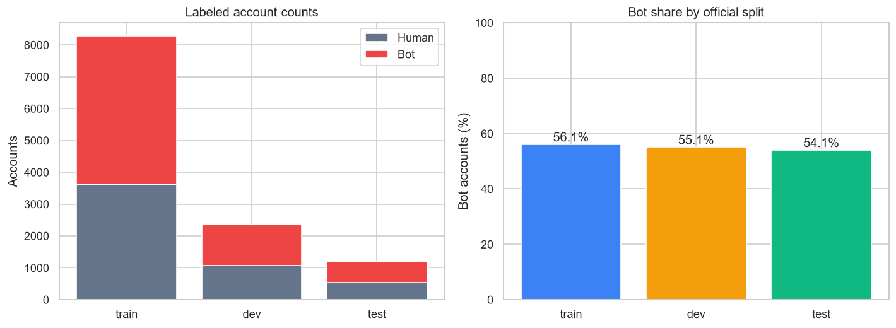
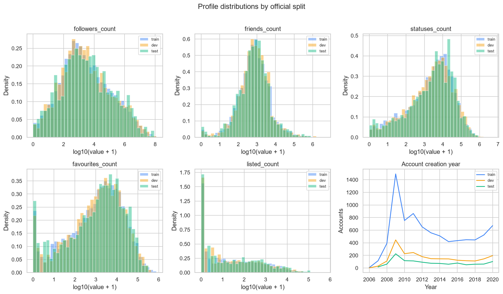
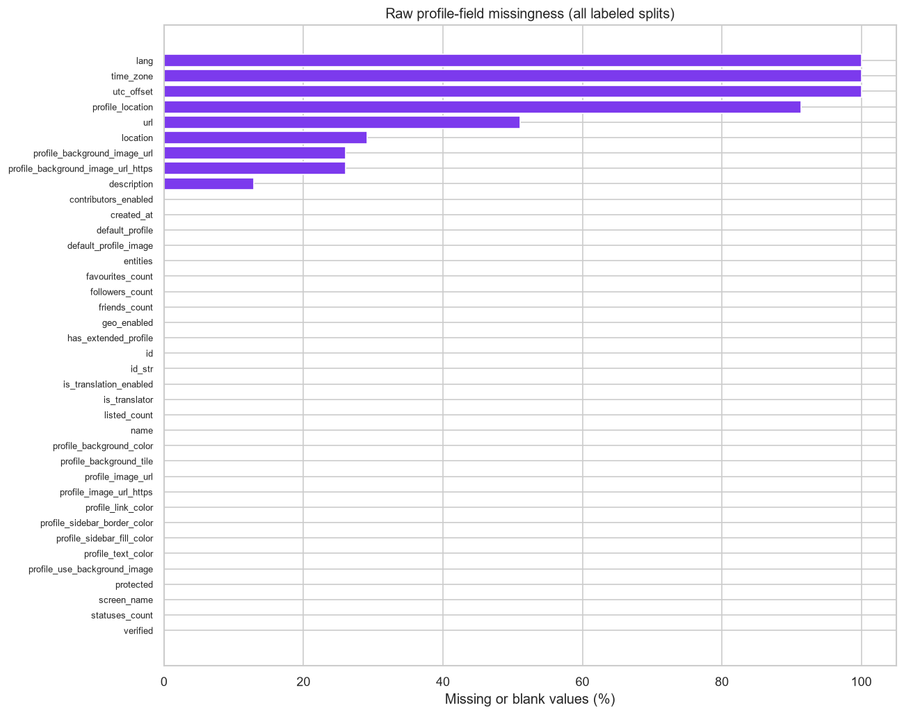
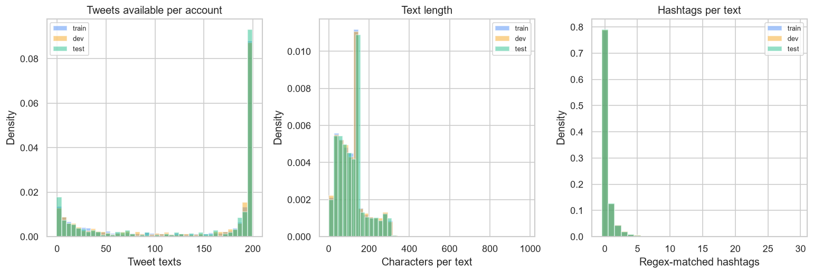
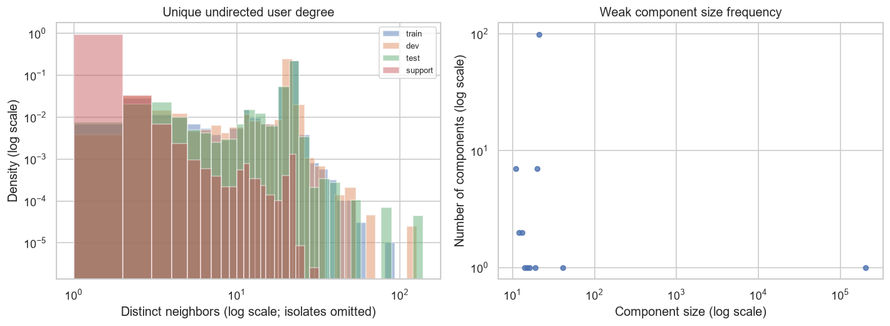

# TwiBot-20 Exploratory Data Analysis — Phase 2

Audit date: 2026-11-06<br>
Scope: descriptive analysis only. No source dataset or archive was modified. No feature engineering or model training was performed.

## Executive summary

- Official labeled splits contain 11,826 accounts: 6,589 bots and 5,237 humans.
- Split account IDs are disjoint: 11,826 unique IDs across train, dev, and test.
- Source tweets are plain text, not structured tweet objects. No per-tweet like, reply, repost, or retweet metrics were present in the records inspected; engagement distributions therefore cannot be computed.
- The converted user graph contains 229,580 roster users and 226,771 unique directed user pairs across `friend`/`follow`. It has 23,973 weak components including isolates; 23,850 users have no friend/follow neighbor.
- Exact text hashes overlap between official splits (train-dev 10,981, train-test 7,126, dev-test 3,286 unique texts). Retweets/common text may explain overlap; exact-text overlap is a contamination risk to review, not proof of account-level leakage.

## Scope, files, and method

Inputs were read-only:

- Original split records: `TwiBot-20-20261106T091806Z-1-002/TwiBot-20/Twibot-20.zip` members `train.json`, `dev.json`, `test.json`.
- Converted graph: `TwiBot-20-Format22-003/Twibot-20/split.csv`, `label.csv`, and `edge.csv`.
- Phase 1 reports: [DATASET_AUDIT.md](./DATASET_AUDIT.md) and [GRAPH_ID_COVERAGE_AUDIT.md](./GRAPH_ID_COVERAGE_AUDIT.md).

The archive arrays were parsed incrementally from ZIP streams. Tweet hashes for cross-split duplicate checks were accumulated in a temporary SQLite database that was removed after analysis. The graph user roster was initialized from `split.csv`; relationship edges were scanned as CSV. Counts refer to actual data read in this run.

Assumptions and transformations:

- `dev` is the official validation split, equivalent to `val` in the converted split file.
- Labels are raw string `"0"` = human and `"1"` = bot, matching the bundled TwiBot-20 README and the Phase 1 label reconciliation.
- Profile missingness means a missing key, JSON `null`, or a string whose stripped, case-insensitive value is empty, `"none"`, `"null"`, or `"nan"`. No record was removed or imputed.
- Numeric summaries parse only finite numeric values. Invalid nonempty numeric representations and negative counts are reported separately; values are not clipped or winsorized.
- Creation-date analysis uses year only. The collection timestamp is not established by the available files, so account age is not calculated.
- Tweet hashtag, mention, and URL counts use the explicit regular expressions in `run_eda.py` on each unmodified text string. They are descriptive pattern counts, not canonical extraction or engineered model features.
- Tweet-text equality uses SHA-256 of exact UTF-8 strings without case, URL, whitespace, or retweet normalization. Matching hashes are counted as exact-text overlaps; no text is discarded.
- Network degree counts distinct directed user pairs across `friend` and `follow`; undirected degree and weak components collapse relation type and reciprocal direction. Isolates include all roster accounts with no such neighbor. `post` edges are excluded from user-network topology.

## Class distribution

| Official split | Accounts | Human (0) | Bot (1) | Bot share |
| --- | --- | --- | --- | --- |
| Train | 8278 | 3632 | 4646 | 56.12% |
| Dev / validation | 2365 | 1062 | 1303 | 55.10% |
| Test | 1183 | 543 | 640 | 54.10% |
| Total | 11826 | 5237 | 6589 | 55.72% |



Class counts differ in absolute size because the official splits differ in size. The observed bot share is shown explicitly; no resampling or split adjustment was applied.

## Profile data

The raw profile object exposes 38 distinct fields across labeled records. Raw counters are shown, not transformed features. The fields below are counts exposed by the source schema; values are not standardized.

| Raw profile count | Train | Dev | Test |
| --- | --- | --- | --- |
| followers_count | n=8278, med=1939.5, p95=1999039.4, max=112403156.0, missing=0 (0.00%), negative=0, invalid=0 | n=2365, med=2017.0, p95=2289659.4, max=121826325.0, missing=0 (0.00%), negative=0, invalid=0 | n=1183, med=2574.0, p95=2351140.2, max=87313765.0, missing=0 (0.00%), negative=0, invalid=0 |
| friends_count | n=8278, med=723.0, p95=14977.9, max=4339982.0, missing=0 (0.00%), negative=0, invalid=0 | n=2365, med=735.0, p95=13310.0, max=1578049.0, missing=0 (0.00%), negative=0, invalid=0 | n=1183, med=748.0, p95=16160.7, max=804528.0, missing=0 (0.00%), negative=0, invalid=0 |
| statuses_count | n=8278, med=3624.0, p95=90989.9, max=5140025.0, missing=0 (0.00%), negative=0, invalid=0 | n=2365, med=3222.0, p95=108955.6, max=1684477.0, missing=0 (0.00%), negative=0, invalid=0 | n=1183, med=4051.0, p95=91038.1, max=859809.0, missing=0 (0.00%), negative=0, invalid=0 |
| favourites_count | n=8278, med=1584.5, p95=62960.0, max=783456.0, missing=0 (0.00%), negative=0, invalid=0 | n=2365, med=1595.0, p95=61380.2, max=438845.0, missing=0 (0.00%), negative=0, invalid=0 | n=1183, med=1884.0, p95=61345.6, max=322238.0, missing=0 (0.00%), negative=0, invalid=0 |
| listed_count | n=8278, med=13.0, p95=5679.2, max=550181.0, missing=0 (0.00%), negative=0, invalid=0 | n=2365, med=13.0, p95=7032.8, max=221299.0, missing=0 (0.00%), negative=0, invalid=0 | n=1183, med=17.0, p95=7336.4, max=118656.0, missing=0 (0.00%), negative=0, invalid=0 |

Distribution plots use `log10(max(value, 0) + 1)` for readability only; summary tables remain in original units. Negative or invalid raw values, if any, are not plotted as negative magnitudes (they remain represented in the negative/invalid counts in the reproducibility script).

### Numeric outlier screening

The following are descriptive Tukey 1.5-IQR fence counts, not data-removal rules. All records remain included:

| Count field | Split | p99 | Maximum | Below lower fence | Above upper fence | Negative values | Invalid nonmissing |
| --- | --- | --- | --- | --- | --- | --- | --- |
| followers_count | Train | 14485314.9 | 112403156.0 | 0 | 1589 | 0 | 0 |
| followers_count | Dev / validation | 15212760.4 | 121826325.0 | 0 | 471 | 0 | 0 |
| followers_count | Test | 19945199.9 | 87313765.0 | 0 | 230 | 0 | 0 |
| friends_count | Train | 107388.6 | 4339982.0 | 0 | 970 | 0 | 0 |
| friends_count | Dev / validation | 93698.8 | 1578049.0 | 0 | 271 | 0 | 0 |
| friends_count | Test | 108881.4 | 804528.0 | 0 | 138 | 0 | 0 |
| statuses_count | Train | 280604.3 | 5140025.0 | 0 | 1023 | 0 | 0 |
| statuses_count | Dev / validation | 267996.0 | 1684477.0 | 0 | 319 | 0 | 0 |
| statuses_count | Test | 287136.0 | 859809.0 | 0 | 119 | 0 | 0 |
| favourites_count | Train | 180114.0 | 783456.0 | 0 | 1098 | 0 | 0 |
| favourites_count | Dev / validation | 176818.9 | 438845.0 | 0 | 318 | 0 | 0 |
| favourites_count | Test | 135886.3 | 322238.0 | 0 | 166 | 0 | 0 |
| listed_count | Train | 27158.6 | 550181.0 | 0 | 1494 | 0 | 0 |
| listed_count | Dev / validation | 29796.6 | 221299.0 | 0 | 416 | 0 | 0 |
| listed_count | Test | 50318.8 | 118656.0 | 0 | 194 | 0 | 0 |



Boolean-like fields are parsed only for descriptive counts (`True`/`1`, `False`/`0`, missing, or other):

| Raw profile flag | Train | Dev | Test |
| --- | --- | --- | --- |
| verified | T=2057, F=6221, missing=0, other=0 | T=581, F=1784, missing=0, other=0 | T=326, F=857, missing=0, other=0 |
| geo_enabled | T=3455, F=4823, missing=0, other=0 | T=988, F=1377, missing=0, other=0 | T=524, F=659, missing=0, other=0 |
| protected | T=1, F=8277, missing=0, other=0 | T=1, F=2364, missing=0, other=0 | T=0, F=1183, missing=0, other=0 |
| default_profile | T=4102, F=4176, missing=0, other=0 | T=1131, F=1234, missing=0, other=0 | T=566, F=617, missing=0, other=0 |
| default_profile_image | T=207, F=8071, missing=0, other=0 | T=63, F=2302, missing=0, other=0 | T=35, F=1148, missing=0, other=0 |

Creation year is shown instead of account age because a defensible API capture/reference date is unavailable.



### Missingness by raw profile field

| Profile field | Train missing | Dev missing | Test missing | All missing (%) |
| --- | --- | --- | --- | --- |
| lang | 8278 | 2365 | 1183 | 11826 (100.00%) |
| time_zone | 8278 | 2365 | 1183 | 11826 (100.00%) |
| utc_offset | 8278 | 2365 | 1183 | 11826 (100.00%) |
| profile_location | 7550 | 2151 | 1101 | 10802 (91.34%) |
| url | 4250 | 1193 | 595 | 6038 (51.06%) |
| location | 2404 | 692 | 354 | 3450 (29.17%) |
| profile_background_image_url | 2183 | 596 | 303 | 3082 (26.06%) |
| profile_background_image_url_https | 2183 | 596 | 303 | 3082 (26.06%) |
| description | 1073 | 299 | 151 | 1523 (12.88%) |
| contributors_enabled | 0 | 0 | 0 | 0 (0.00%) |
| created_at | 0 | 0 | 0 | 0 (0.00%) |
| default_profile | 0 | 0 | 0 | 0 (0.00%) |
| default_profile_image | 0 | 0 | 0 | 0 (0.00%) |
| entities | 0 | 0 | 0 | 0 (0.00%) |
| favourites_count | 0 | 0 | 0 | 0 (0.00%) |
| followers_count | 0 | 0 | 0 | 0 (0.00%) |
| friends_count | 0 | 0 | 0 | 0 (0.00%) |
| geo_enabled | 0 | 0 | 0 | 0 (0.00%) |
| has_extended_profile | 0 | 0 | 0 | 0 (0.00%) |
| id | 0 | 0 | 0 | 0 (0.00%) |
| id_str | 0 | 0 | 0 | 0 (0.00%) |
| is_translation_enabled | 0 | 0 | 0 | 0 (0.00%) |
| is_translator | 0 | 0 | 0 | 0 (0.00%) |
| listed_count | 0 | 0 | 0 | 0 (0.00%) |
| name | 0 | 0 | 0 | 0 (0.00%) |
| profile_background_color | 0 | 0 | 0 | 0 (0.00%) |
| profile_background_tile | 0 | 0 | 0 | 0 (0.00%) |
| profile_image_url | 0 | 0 | 0 | 0 (0.00%) |
| profile_image_url_https | 0 | 0 | 0 | 0 (0.00%) |
| profile_link_color | 0 | 0 | 0 | 0 (0.00%) |
| profile_sidebar_border_color | 0 | 0 | 0 | 0 (0.00%) |
| profile_sidebar_fill_color | 0 | 0 | 0 | 0 (0.00%) |
| profile_text_color | 0 | 0 | 0 | 0 (0.00%) |
| profile_use_background_image | 0 | 0 | 0 | 0 (0.00%) |
| protected | 0 | 0 | 0 | 0 (0.00%) |
| screen_name | 0 | 0 | 0 | 0 (0.00%) |
| statuses_count | 0 | 0 | 0 | 0 (0.00%) |
| verified | 0 | 0 | 0 | 0 (0.00%) |

Blank sentinel values occur in addition to JSON null/missing keys. The missingness plot and table do not fill any values. `profile_missingness.png` includes the profile-key union and treats absent keys as missing.

## Tweet availability and text

| Split | Accounts | Tweet missing/non-list | Empty list | Text items | Tweets/list median | Tweets/list p95 | Blank text items | Chars/text median | Words/text median | Hashtags/text median | Mentions/text median | URLs/text median | Repeated text within same account | Non-string tweet items |
| --- | --- | --- | --- | --- | --- | --- | --- | --- | --- | --- | --- | --- | --- | --- |
| Train | 8278 | 55 | 0 | 1398410 | 200 | 200 | 0 | 114 | 16 | 0 | 1 | 0 | 10038 | 0 |
| Dev / validation | 2365 | 15 | 0 | 401525 | 200 | 200 | 0 | 115 | 16 | 0 | 1 | 0 | 2573 | 0 |
| Test | 1183 | 10 | 0 | 199853 | 200 | 200 | 0 | 113 | 16 | 0 | 1 | 0 | 2242 | 0 |

The raw tweet field consists of text strings. The source schema does not expose structured engagement counters; exact tweet-level like/reply/repost metrics are unavailable here. Accordingly, no engagement values are fabricated or inferred from labels or graph edge counts.



Tweet list lengths are variable, and missing/non-list fields are distinguished from empty lists. Blank text strings and repeated text within a single account are counted, not removed.

### Exact text overlap and split contamination

| Check | Unique text hashes |
|---|---:|
| Unique exact texts in train | 1,355,841 |
| Unique exact texts in dev | 395,483 |
| Unique exact texts in test | 196,384 |
| Train and dev | 10,981 |
| Train and test | 7,126 |
| Dev and test | 3,286 |
| Present in all three splits | 2,098 |

These are text-level overlaps, not duplicate accounts. Identical posts can arise from retweets, shared announcements, or copied content. The counts flag a possible text-level contamination pathway for any later text-based evaluation; they do not prove that labels, accounts, or train/test records were copied. Split IDs themselves are disjoint. No deduplication was performed.

## Network structure

### Relationship edge types

| Relation | Rows in edge.csv |
| --- | --- |
| follow | 110869 |
| friend | 117110 |
| post | 33488192 |

### Degree and isolates

Degree is the number of distinct neighboring user IDs across the union of `friend` and `follow` directed pairs, treated as undirected for this table. It is not a follower-count profile metric.

| Cohort | Accounts | Isolates | Isolate share | Median degree | p95 degree | Max degree |
| --- | --- | --- | --- | --- | --- | --- |
| train | 8278 | 9 | 0.11% | 21.0 | 22.0 | 93 |
| dev | 2365 | 1 | 0.04% | 21.0 | 22.0 | 127 |
| test | 1183 | 2 | 0.17% | 21.0 | 22.0 | 139 |
| support | 217754 | 23838 | 10.95% | 1.0 | 1.0 | 32 |

- Unique directed user pairs: 226,771; reciprocal directed pair pairs: 660.
- Unique `friend`/`follow` relationship rows after duplicate exclusion: 227,979; exact duplicate relation rows: 0; self-loop relation rows: 0.
- Cross-cohort relation edges (different train/dev/test/support cohort endpoints): 202,408. These are transductive graph links, not direct label leakage, but their use in any later evaluation must be documented and consistent with the chosen protocol.
- Weakly connected components (all roster nodes, including isolates): 23,973; largest component sizes: 203279, 41, 21, 21, 21, 21, 21, 21, 21, 21.
- Overall distinct directed-pair in-degree: median 1.0, p95 1.0, max 124; out-degree: median 0.0, p95 11.0, max 20.



### Directed degree and split-cohort edge counts

Directed degrees count unique source-target pairs after collapsing `friend` and `follow` for combined in/out degrees. Relation-specific degree rows count distinct edges within that relation.

| Degree | Median | p95 | Maximum | Zero-degree nodes |
| --- | --- | --- | --- | --- |
| in-degree | 1.0 | 1.0 | 124 | 25152 |
| out-degree | 0.0 | 11.0 | 20 | 217656 |
| friend source | 0.0 | 10.0 | 10 | 217752 |
| follow source | 0.0 | 1.0 | 10 | 217939 |
| friend target | 0.0 | 1.0 | 124 | 130521 |
| follow target | 0.0 | 1.0 | 22 | 121022 |

Cross-cohort rows below count literal relation edges, not unique user pairs after combining relation types:

| Relation | Source cohort → target cohort | Edges |
| --- | --- | --- |
| follow | dev->dev | 189 |
| follow | dev->support | 19617 |
| follow | dev->test | 88 |
| follow | dev->train | 709 |
| follow | support->dev | 90 |
| follow | support->support | 7362 |
| follow | support->test | 53 |
| follow | support->train | 349 |
| follow | test->dev | 88 |
| follow | test->support | 9812 |
| follow | test->test | 38 |
| follow | test->train | 320 |
| follow | train->dev | 754 |
| follow | train->support | 68568 |
| follow | train->test | 367 |
| follow | train->train | 2465 |
| friend | dev->dev | 456 |
| friend | dev->support | 18793 |
| friend | dev->test | 213 |
| friend | dev->train | 1656 |
| friend | support->dev | 487 |
| friend | support->support | 9061 |
| friend | support->test | 255 |
| friend | support->train | 1606 |
| friend | test->dev | 217 |
| friend | test->support | 9404 |
| friend | test->test | 116 |
| friend | test->train | 819 |
| friend | train->dev | 1634 |
| friend | train->support | 65614 |
| friend | train->test | 895 |
| friend | train->train | 5884 |

### Weak component size frequency

The table lists the 15 most frequent component sizes; the full size-frequency distribution is included in the chart.

| Component size | Component count |
| --- | --- |
| 1 | 23850 |
| 21 | 99 |
| 11 | 7 |
| 20 | 7 |
| 12 | 2 |
| 13 | 2 |
| 14 | 1 |
| 15 | 1 |
| 16 | 1 |
| 19 | 1 |
| 41 | 1 |
| 203279 | 1 |

All counts were obtained on the complete account roster. The graph visualization excludes isolates from the log-scaled degree histogram and excludes size-1 components from the plotted nontrivial component-frequency scatter; tables retain them.

## Duplicates, outliers, and inconsistencies

- **Account IDs:** no within-split duplicates; official split IDs are pairwise disjoint. A cross-split ID overlap would have stopped this run.
- **Profile duplicates:** exact profile signatures excluding `id`, `id_str`, and `screen_name` yielded 0 duplicate groups and 0 extra records; 0 such groups span more than one split. Shared default/empty profile attributes can make signatures coincide, so this is a screening signal, not proof of duplicate accounts.
- **Profile numeric outliers:** count variables are heavy-tailed and displayed on a log scale. No rows were removed; distribution summaries use raw values. See `run_eda.py` for the scanned numeric domain and generated descriptive plots.
- **Tweet records:** list lengths vary, blank texts and exact repeats are counted, and text overlap across splits is quantified above. No tweets/accounts were removed.
- **Graph data:** edge schema was checked during full scan. Duplicate relation rows and self-loops are counted above. Relationship meaning is kept as the literal `friend`/`follow` label; direction semantics are not inferred beyond source/target columns.
- **Profile-to-ID consistency:** after trimming surrounding whitespace only, source account `ID` was compared with profile `id` and `id_str`. Results: 0 missing `id`, 0 mismatched `id`; 0 missing `id_str`, 0 mismatched `id_str`. Identity fields should still be avoided or justified separately.

## Leakage and split-contamination investigation

1. **Account-level overlap:** train/dev/test IDs are disjoint, with 11,826 total unique labeled IDs.
2. **Target field:** raw labeled records contain a top-level `label` key. It is the target and must be excluded from all predictor inputs. This EDA does not construct predictors.
3. **Identity fields:** account IDs, profile IDs, screen names, and usernames are identifiers, not safe predictors by default. Label association or collection-order artifacts could make them leakage channels; they require exclusion or a documented, justified policy before modeling.
4. **Graph leakage:** the converted graph includes all roster users and cross-cohort links. It has no evidence in this EDA of label values embedded in graph user-node features; labels are maintained in separate label/split files. However, graph-derived statistics over the full graph are transductive and may incorporate dev/test topology. Any future evaluation must state whether transductive graph access is permitted and must not propagate target labels from validation/test/support.
5. **Exact tweet-text overlap:** see the table above. Shared texts are present across splits and may inflate text-based generalization estimates even though account IDs are disjoint. Consider reporting a separate exact-text-grouped sensitivity evaluation in a future experimental design, without altering the official split-based primary result.
6. **No test tuning:** this phase is descriptive only; no model, threshold, or feature choice was selected using test performance.

## Limitations

- The source bundle does not provide per-tweet engagement counts, so engagement distributions cannot be reported.
- No trustworthy data-collection timestamp was identified; account age in days is not computed.
- Text counts are regex-based; they do not use a Twitter tokenizer, sentiment model, language identification, or URL expansion.
- Exact matching of text does not detect near-duplicates or semantically equivalent tweets.
- Graph degree/component results depend on the converted `friend`/`follow` edges; they do not establish the semantics, recency, or completeness of the underlying API relationships.
- This report compares official labeled splits. Support-account profiles are not mixed into labeled profile distributions; support is included in complete-roster graph topology.
- The Phase 1 audit records that the `.pt` file was not deserialized. It is not used in this EDA.

## Recommendations for Phase 3

1. Preserve official train/dev/test account membership and labels exactly; keep support accounts unlabeled.
2. Explicitly exclude the top-level target and identity fields from ordinary predictive inputs unless a leakage analysis justifies otherwise.
3. Handle blank/sentinel values explicitly, retain missingness indicators, and fit any learned imputation/encoding only on training data.
4. Decide and document whether the graph experiment is transductive. Report a profile-only baseline separately before adding tweet or graph-derived inputs.
5. Account for exact tweet overlap in the interpretation of text-based results; retain the official split as primary and treat any grouped sensitivity analysis as supplementary.
6. Do not synthesize tweet engagement metrics from text or graph edges. Design live-compatibility work only after measuring fields actually available from the intended API.
7. Keep this EDA descriptive: no features, preprocessing pipeline, model, or test-set tuning was created.

## Reproducibility

Run from the repository root with the configured Python environment:

```powershell
python .\twis20\run_eda.py
```

The script writes this report and PNGs under `twis20/eda_figures/`; it does not write into the dataset package or archives. Analysis details and parsing rules are in [run_eda.py](./run_eda.py).
